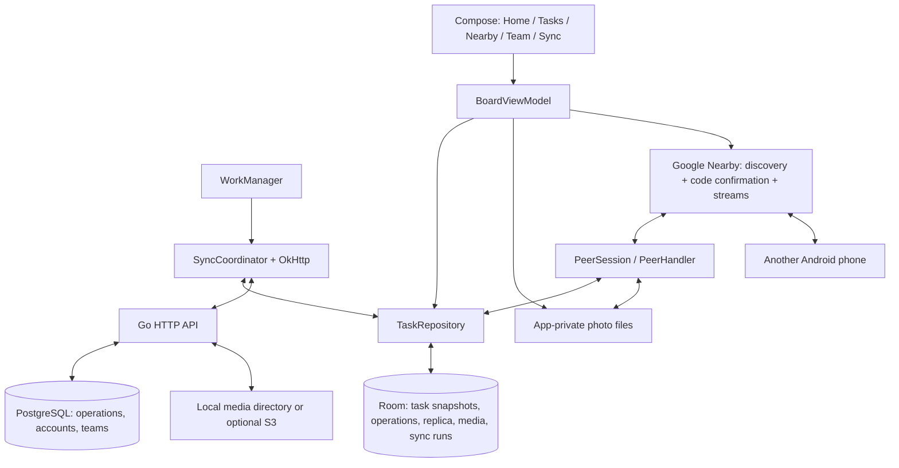

# How FieldSync works

## One offline edit

The repository opens a Room transaction, increments the persisted Lamport clock,
creates a UUID operation, updates its task snapshot, and appends the operation with
`cloudAcknowledged=false`. Room emits the snapshot to Compose. WorkManager is then
enqueued; a failed network request cannot roll back the saved edit.

Every task/operation/media row belongs to a workspace. `demo` is public; team IDs
identify private workspaces. The device actor and clock are shared across workspaces,
while cloud cursors reset when switching. Returning to a team re-downloads its log;
existing operation IDs deduplicate the replay. This avoids a separate cursor table.

## CRDTs, with an explicit status decision

Ordinary fields are LWW registers storing `(value, clock, actorId)`. The larger
clock wins; ASCII actor ID breaks ties. Different fields merge independently.
A checklist has separate label/result/note/deletion registers per item. Each photo
hash has a metadata register; an empty value removes its visible attachment.

Status uses a multi-value register. Each status operation contains its chosen value
and IDs of the active status versions the user saw. Applying it adds the version
and unions those observed IDs into a superseded set. A version is active if its ID
has not been superseded. Concurrent different active values display a conflict.

For example, both phones see status `s0=open`. Offline, A writes `s1=completed`
observing `s0`; B writes `s2=blocked` observing `s0`. Merging retains `s1` and `s2`.
The user resolves to `s3=in_progress` observing both. Even if `s3` arrives first,
its superseded IDs ensure later delivery of `s1`/`s2` cannot revive the conflict.
Concurrent identical statuses need no user decision, although their version IDs
remain active until the next status update supersedes them.

LWW maximum and set union are associative, commutative, and idempotent. Every store
also rejects reuse of an operation ID or `(actorId, clock)` with different content.
Eventual delivery of valid operations therefore makes replicas converge. Wall-clock
timestamps are for activity display only. The old completion boolean is supported
for migration; new task status operations take precedence.

## Cloud synchronization

The coordinator serializes cloud sessions, workspace changes, sign-out, and server
URL changes with a mutex. It uploads pending photo files, uploads pending operations
in batches of 100, and downloads paginated server operations. It finally downloads
referenced photos that are absent locally. Failed sessions retain pending work.

PostgreSQL assigns sequence cursors. A workspace advisory lock covers insertion,
read, and commit so another request cannot advance past an uncommitted operation.
The cursor means last returned server sequence, not a Lamport clock. Android commits
downloads, acknowledgments, and cursor together. A lost response causes a safe retry.
Imported peer operations remain pending so either phone can forward them to cloud.

The Go API validates JWTs, current team membership, roles, and private assignee
membership. An owner manages editor/viewer roles; new invite joins are viewers.
Viewers can pull cloud data without uploading their outbox. The public demo is
deliberately separate and needs no account. Accounts require PostgreSQL.

Photo operations contain metadata; SHA-256-addressed files travel separately.
Both peers and server verify hash/size. The backend additionally checks image type.
Local storage is the default; the optional AWS SDK adapter provides S3 PUT/GET.
Removing an attachment hides it but retains its file, avoiding unsafe distributed GC.

## Nearby synchronization

Google Nearby handles discovery and encrypted device communication. Both users
must approve a matching connection code. A workspace-specific service ID helps
devices discover the same team; it does not replace server membership validation.
This local learning protocol trusts explicitly paired teammates.

The initiating phone pushes paginated operations and available photos, then pulls
the other phone's log and missing photos. `PeerSession` defines that exchange;
`NearbyManager` only handles radios, framing, requests/timeouts, and progress.
Request IDs match replies. JSON travels as Nearby STREAM payloads; photos are
base64 inside bounded frames. Whole-session retry is simpler than chunk checkpoints.

Each exchange replays the entire log, avoiding per-peer checkpoint bookkeeping.
New edits during a session may need another exchange. The foreground connection
stops when the activity leaves the screen. An operations-only NanoHTTPD fallback
is retained for public-demo LAN/emulator tests.

## Deliberate limits

No log compaction, rich-text merging, untrusted-client Byzantine defense, background
peer service, or production account lifecycle. Cached offline roles cannot detect
a later server revocation until reconnecting. Files and local account tokens live
in app-private storage without a separate encrypted vault. The health endpoint
checks the HTTP process, not continuous database readiness. See the README for
the demonstration procedure and exact validation boundaries.
